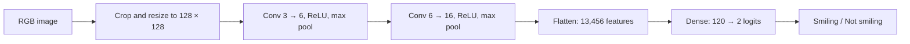

# Smile Classification with CelebA

A compact PyTorch image classifier that predicts whether a face image is labeled **smiling** or **not smiling**. The project covers the full modeling workflow: image preprocessing, a LeNet-style CNN, validation-based checkpoint selection, and batch prediction.

**Python · PyTorch · Computer Vision · Binary Classification**

**Historical result:** approximately **92% on Kaggle**, recalled from the original experiment. The exact score, leaderboard split, and associated checkpoint have not been recovered. This score is not a measured result of the corrected implementation included here.

## Approach

Faces are center-cropped to 178 × 178, resized to 128 × 128, and normalized to approximately [-1, 1]. Two convolutional blocks learn spatial features, followed by a small classifier that outputs two class logits. Cross-entropy trains the network; the checkpoint with the lowest validation loss is retained.



This is a deliberately compact baseline for exploring how a convolutional model learns from image data. It uses no pretrained weights or augmentation. A visible-smile label should not be interpreted as a person's emotional state.

| Default | Value |
| --- | --- |
| Input | 3 × 128 × 128 |
| Convolution kernels | 5 × 5, no padding |
| Pooling | 2 × 2, stride 2 |
| Optimizer | SGD, momentum 0.9 |
| Learning rate | 0.001 |
| Epochs | 20 |
| Batch size | 64 |
| Seed | 190 |
| Model selection | Lowest validation cross-entropy |

## Data

The original experiment uses these supplied splits from CelebA:

| Split | Images | Not smiling (0) | Smiling (1) |
| --- | ---: | ---: | ---: |
| Training | 50,000 | 25,000 | 25,000 |
| Validation | 2,000 | 1,000 | 1,000 |

The original CSVs contain unique image filenames, with no image IDs shared across the training and validation lists. Identity-level overlap was not checked. The competition sample submission has 2,000 rows; its example labels are not ground truth.

Obtain the aligned images from [CelebA on Kaggle](https://www.kaggle.com/datasets/jessicali9530/celeba-dataset). The original split manifests come from the [MP1 competition](https://www.kaggle.com/competitions/cs190-winter23-deep-learning-mp1); access may depend on competition enrollment. This repository does not redistribute those files. You can instead supply your own disjoint image manifests with the same schema; results on different splits are not directly comparable to the historical competition score.

A manifest has two columns:

```csv
id,label
000001.jpg,0
000002.jpg,1
```

The rows above illustrate the format only; they are not verified CelebA annotations. Use actual labels when creating a manifest.

## Run the project

Use Python 3.10 or newer. From this project directory:

```bash
python -m venv .venv
source .venv/bin/activate
pip install -r requirements.txt
```

Arrange your data as follows, with the JPEGs directly under `images/`:

```text
data/
├── images/
│   ├── 000001.jpg
│   └── ...
├── celeba_train.csv
└── celeba_valid.csv
```

Train a model:

```bash
python src/pipeline.py train \
  --image-dir data/images \
  --train-csv data/celeba_train.csv \
  --valid-csv data/celeba_valid.csv \
  --output outputs/baseline
```

The script selects CUDA, Apple Silicon MPS, or CPU automatically. Use `--device cpu` to force CPU, and `--batch-size 16` if memory is limited. Seeds reduce random variation; exact cross-device reproducibility is not guaranteed.

Each run writes `config.json` (settings and framework versions), `history.json` (per-epoch training and validation metrics), and `best.pt` (model weights and checkpoint metadata). Accuracy values in the history are fractions from 0 to 1. Choose a fresh output directory for each experiment so earlier results remain intact.

Generate predictions for a folder of JPEG or PNG images:

```bash
python src/pipeline.py predict \
  --image-dir data/new-images \
  --checkpoint outputs/baseline/best.pt \
  --output outputs/predictions.csv
```

The output contains `id`, `label`, and `smile_probability`, with image filenames as IDs in sorted order. These probabilities are uncalibrated model outputs. This is a general image-folder prediction interface, not the legacy Kaggle submission format. The archived notebook documents the old `test_img.pt` workflow; the new script does not load that serialized dataset or old whole-model checkpoints.

## Implementation history

The original work filled in the gradient-update and validation operations and implemented a LeNet-style forward pass on top of a supplied pipeline. The downloaded notebook is preserved unchanged in [the archive](notebooks/kaggle-original.ipynb).

The **October 2026 portfolio revision** adds a separate command-line implementation with:

- The correct 16 × 29 × 29 feature size for 128 × 128 inputs.
- Two raw class logits matched to cross-entropy and class predictions.
- Gradient-free validation and sample-weighted loss reporting.
- Checks for malformed labels, duplicate image IDs, and overlapping splits.
- Portable model-weight checkpoints, experiment logs, and configurable data paths.

The archived export stops at an incorrectly typed Markdown cell and contains model-shape and loss inconsistencies. Those details are documented in the [implementation review](REVIEW.md). The new code is a later repair, not evidence of which exact implementation produced the historical score.

## Verification

Run the dependency-free data checks:

```bash
python -m unittest discover -s tests -p 'test_manifest.py' -v
```

After installing the dependencies, run the integration checks:

```bash
python -m unittest discover -s tests -v
```

The integration checks use generated images to exercise model dimensions, a one-epoch training run, checkpoint loading, and prediction output. Synthetic-image checks do not measure classification quality.

**Checked locally:** Python syntax, data-manifest tests, original split statistics, archive integrity, and local documentation links. **Not yet run:** the integration checks and full CelebA training. PyTorch was unavailable in the review environment, and dependency installation was not completed. No new accuracy is claimed.

## Next experiments

- Compare this CNN against the original linear baseline on the same split.
- Measure the effect of horizontal flips and mild color augmentation.
- Compare SGD with Adam while keeping evaluation conditions fixed.
- Inspect false positives, false negatives, and probability calibration.
- Record training curves and a confusion matrix from a reproducible run.

These are proposed experiments, not completed results.

## References and provenance

This project began in UCSB CS 190I (Winter 2023) and was later organized as a portfolio project. The original dataset loader, preprocessing, training scaffold, and submission framework came from the course materials; the historical modifications and later repairs are described above.

- [Original project specification, instructor Lei Li](https://lileicc.github.io/course/dl23w/mp1/cs190I_dl23w_mp1.pdf)
- [Original starter notebook](reference/course-template.ipynb)
- [Historical environment file](reference/environment-original.yml)
- [Archived Kaggle notebook](notebooks/kaggle-original.ipynb)

Course materials and datasets retain their original terms. No new license is asserted over those materials.
